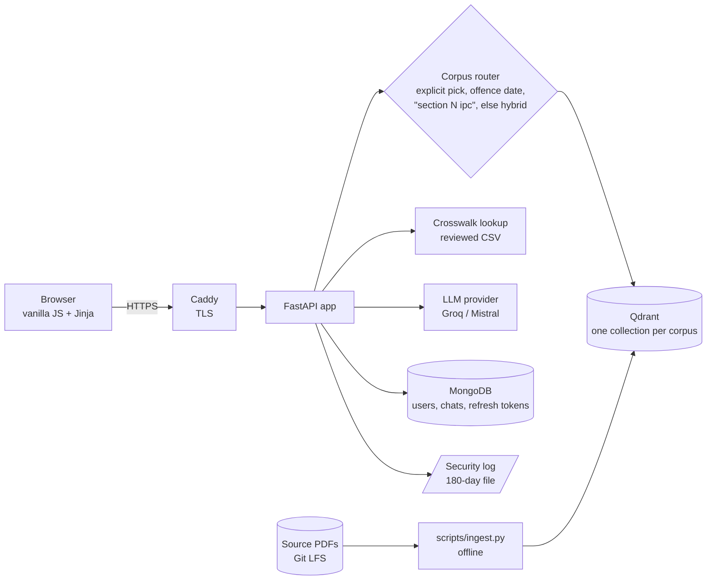

# JurisAI

A retrieval-augmented legal assistant for **Indian criminal law**. Ask a question in plain
language; JurisAI finds the relevant sections of the **Indian Penal Code (IPC)** and the
**Bharatiya Nyaya Sanhita (BNS)**, answers from that text with section citations, and shows a
human-reviewed IPC ↔ BNS correspondence so you can tell what a section became after the
1 July 2024 changeover.

> **JurisAI is not a lawyer and does not give legal advice.** It summarises statute text for
> general understanding and can be incomplete, out of date, or wrong. Verify every section
> against the official text, and consult a qualified lawyer before acting on anything it says.
> Free legal aid in India: NALSA helpline **15100**. The app repeats this wording to every
> user, more strongly for self-declared citizens than for lawyers and police.

## Results at a glance

The hit rates are produced by the `eval` jobs in CI (`scripts/eval.py`), and the test and coverage figures by the `test` job.

| Measure | Result |
|---|---|
| Retrieval hit rate (CI eval sets) | IPC 18/20 (90%), BNS 12/14 (86%) — small sets, wide error bars |
| Tests / coverage | 164 tests; 86% overall; 100% on the 8 auth and ownership files |
| Lighthouse accessibility | 1.00 on all 5 pages |
| Not measured yet | Accuracy gain over the first prototype, answer correctness, FIR time saved |

## Status

| Area | State |
|---|---|
| IPC + BNS question answering with citations, streaming | Working |
| IPC ↔ BNS crosswalk | 380 rows, all human-reviewed; only reviewed rows can reach an answer |
| Accounts (signup/login/refresh/logout/delete), per-user chat history | Working |
| Web UI (chat, history, account, settings, templates, privacy notice) | Working; Lighthouse accessibility 1.00 |
| DPDP consent, privacy notice (English + Hindi), grievance officer | Built — **Hindi text needs a native-speaker review; notice needs legal review** |
| CERT-In security log (180 days, on the VM) | Built |
| Production deployment files (Caddy, compose overlay, backups) | Built and validated locally — **not yet run on a real Oracle VM** |
| **FIR form** | **Not built** — blocked on real-world requirements. The Templates page shows it as "Coming soon". |
| Hindi / exact-section-number retrieval | Not built (English-only embeddings) — issues #58, #59 |

## How it works



A question goes through these steps (`backend/app/api/chat.py`):

1. **Route** to a corpus — an explicit IPC/BNS choice, an offence date (`corpora/registry.py`
   knows each act's in-force window), a citation like "section 302 IPC", or both acts by default.
2. **Retrieve** the closest sections from Qdrant (embedding + query run off the event loop).
   If a story-style question matches nothing, one LLM rewrite into legal terms is tried once.
3. **Ground** the prompt in the retrieved text plus the *reviewed* crosswalk rows for any
   section involved — the model is told the correspondence, never asked to recall it.
4. **Answer** via the `LLMProvider` protocol (`llm/`), streamed as server-sent events with a
   structured `crosswalk` field the UI shows as a collapsible panel.
5. **Persist** the turn under the caller's `user_id`. Every session query is scoped by user;
   another user's session id returns 404, never 403.

## Quick start (local)

Requirements: Docker with Compose, [`uv`](https://docs.astral.sh/uv/), Git LFS.

```bash
git clone https://github.com/innovator-sh/jurisai.git && cd jurisai
git lfs pull                      # the two source PDFs live in LFS
cp .env.example .env              # then fill in values (see below)
uv sync
docker compose up -d qdrant
uv run python scripts/ingest.py --corpus ipc     # first run downloads a ~400 MB embedding model
uv run python scripts/ingest.py --corpus bns
docker compose up -d --build     # app + MongoDB + Qdrant
```

Open <http://localhost:8000/login>, sign up (choose a role, accept the notice), and ask a question.

**Minimum `.env` for local use:** `JWT_SECRET_KEY` (`python -c "import secrets; print(secrets.token_urlsafe(32))"`),
`GROQ_API_KEY` (free tier) or `LLM_PROVIDER=mistral` + `MISTRAL_API_KEY`, and `COOKIE_SECURE=false`
(a `Secure` cookie is never sent over plain `http://localhost`). Everything else has a default.
`ENVIRONMENT=production` additionally *requires* the grievance-officer and log-directory
settings — see [`.env.example`](.env.example).

### Checks (all run in CI)

```bash
uv run ruff check .
uv run mypy backend/app
uv run pytest -q --cov                 # needs no Docker: Mongo, Qdrant and the LLM are mocked
python scripts/eval.py --corpus ipc    # retrieval hit-rate report (downloads the model; slow)
```

CI fails the build if overall coverage drops below **70%**, or if any of the auth/ownership
files (`api/auth.py`, `api/sessions.py`, `core/security.py`, `core/rate_limit.py`,
`core/security_log.py` and the three repositories) drops below **100%**.

## Deploy

One Oracle Cloud Always Free VM (Mumbai/Hyderabad), `docker compose` with Caddy for TLS,
self-hosted MongoDB and Qdrant, nightly backups, ₹0/month. The deployment files are in this
repository: `docker-compose.prod.yml`, `Caddyfile` and `scripts/`.

```bash
docker compose -f docker-compose.yml -f docker-compose.prod.yml up -d --build
```

## Configuration

| Variable | Purpose | Default |
|---|---|---|
| `MONGO_URI`, `JWT_SECRET_KEY` | required | — |
| `LLM_PROVIDER` + that provider's key | `groq` · `mistral` · `anthropic` · `bedrock` (last two are stubs) | `groq` |
| `QDRANT_URL` | vector store | `http://qdrant:6333` |
| `CORS_ORIGINS` | comma-separated allowed origins | `http://localhost:8000` |
| `COOKIE_SECURE` | `false` only for plain-HTTP local use | `true` |
| `RETRIEVAL_K`, `RETRIEVAL_SCORE_THRESHOLD` | retrieval tuning | `5`, `0.5` |
| `ENVIRONMENT` | `production` enforces the compliance settings below | `development` |
| `GRIEVANCE_OFFICER_NAME/EMAIL/ADDRESS` | DPDP contact shown on `/privacy` | — (required in production) |
| `SECURITY_LOG_DIR` | CERT-In log directory | — (required in production) |
| `CHAT_RETENTION_DAYS` | chats auto-expire (Mongo TTL index) | `365` |
| `BACKUP_RETENTION_DAYS` | backup archive lifetime | `14` |
| `DOMAIN` | Caddy's public hostname | — (production overlay) |

## Corpus provenance

Every answer is only as good as its source text, so each source is recorded here. Adding or
changing one means updating this table **and** the checksum.

| Corpus | Source file | Origin | SHA-256 |
|---|---|---|---|
| IPC, 1860 | `data/ipc/ipc-data.pdf` | An annotated *commentary* edition (statute text interleaved with case law and footnotes), inherited from the legacy prototype. **Original publisher/edition is not recorded** — see Known gaps. | `5706a1b995df774c4c4ea1868223e18a13ba619977d323d3cab76a1cc095e237` |
| BNS, 2023 | `data/bns/bns-data.pdf` | NCRB's published bare-act PDF, retrieved 2026-09-18; chosen over the MHA Gazette copy because it includes the section index and the official correspondence table. Section count checked against the official 358. | `a83f12a93e32c9e0b39a85f75850a448dc4682b1b44b2d6bd680165bb9931549` |
| IPC ↔ BNS crosswalk | `data/crosswalk/ipc_bns.csv` | 380 rows built from the NCRB "Corresponding Section Table" (356 rows) plus 24 inferred-repealed candidates; every row human-reviewed (`confidence=reviewed`). | (plain-text CSV, reviewed in git history) |

## MVP stack vs. funded-phase swaps

Everything at MVP is free/open-source and self-hosted. A funded phase swaps components behind
the interface that already exists for each — no rewrite.

| Layer | MVP (shipped, ₹0) | Funded-phase swap |
|---|---|---|
| Web | FastAPI + uvicorn, Jinja, vanilla JS (`marked` + `DOMPurify` vendored, strict CSP) | unchanged |
| Auth | Self-hosted JWT, argon2, rotating refresh cookie | Departmental SSO / OIDC |
| LLM | Groq (default) / Mistral free tiers via `LLMProvider` | Bedrock `ap-south-1`, or self-hosted vLLM |
| Vector store | Qdrant OSS, one collection per corpus | Qdrant Cloud |
| Chat store | Self-hosted MongoDB | MongoDB Atlas (Mumbai) |
| Embeddings | `multi-qa-mpnet-base-dot-v1` (English only) | BGE-M3 hybrid dense+sparse (#58, #59) |
| Hosting | Oracle Cloud Always Free + Caddy | AWS `ap-south-1` / NIC cloud |
| Logs | JSON to stdout + 180-day rotating file on the VM | A managed log store *hosted in India* |
| Secrets | Gitignored `.env` on the VM | A secret manager |

## How to add a corpus

BNSS and BSA are the likely next acts. A corpus is **one registry entry, one loader, one
ingest run, and an eval set** — but read the caveat at the end first.

1. **Get an authentic source.** India Code or the Gazette of India only, never a draft or an
   unofficial re-typeset copy — a bad source silently corrupts every answer. Put the PDF in
   `data/<id>/` (it is tracked by Git LFS via `.gitattributes`).
2. **Record provenance.** Add a row to the table above: where it came from, the retrieval date, the
   SHA-256 (`sha256sum data/<id>/*.pdf`).
3. **Declare it** in `backend/app/corpora/definitions.yaml`: `id`, `act`, `short` (this is the
   name users type, e.g. `section 438 BNSS`), `in_force_from`/`in_force_to`, `source`,
   `collection`, `loader`, `enabled`. Never write the id as a string anywhere else.
4. **Write the loader** `backend/app/corpora/loaders/<name>.py`. Do **not** assume the new act
   is typeset like the others — the IPC loader finds zero sections in the BNS PDF and the
   reverse. Expose `extract_sections(pages: list[str]) -> tuple[list[RawSection], list[str]]`
   (see `bns_bare_act.py`) and register it in `LOADERS` in `backend/app/rag/ingest.py`.
   Check the extracted section count against the act's official count, and spot-check known
   sections, before trusting it.
5. **Ingest:** `uv run python scripts/ingest.py --corpus <id>`, then restart the app.
6. **Add an eval set** `backend/tests/eval/<id>_questions.yaml` (only high-confidence,
   verified expectations) and run `python scripts/eval.py --corpus <id>`.
7. **Add tests** for the loader against a few real sections, in `backend/tests/test_loaders.py`.
8. **If it supersedes or maps to another act**, the correspondence must be a reviewed CSV like
   `data/crosswalk/ipc_bns.csv` — never model output. Unreviewed rows must not reach an answer.

> **Caveat — read before adding a *different-subject* act.** The router has no notion of
> subject area. With the default "hybrid" routing, *every enabled corpus is searched for every
> question*, and the date router returns the first enabled act whose in-force window covers
> the date. That is correct for IPC/BNS (successive versions of one subject). Adding BNSS
> (procedure) or BSA (evidence) as-is would put them in every IPC/BNS answer and make their
> date windows collide with BNS. Decide how acts of different subjects are routed (an explicit
> subject field on the corpus, or opt-in selection in the UI) **before** enabling one. Also,
> `corpora/crosswalk.py` is specific to the IPC↔BNS pair.

## Security and compliance

- **Auth:** argon2 password hashes; 15-minute access token held in memory only; 7-day refresh
  token in an httpOnly, `SameSite=Strict`, `Secure` cookie, rotated on every use with replay
  rejected; logout and account deletion revoke server-side.
- **Web:** strict CSP (`default-src 'self'`), no inline script or style, no third-party loads;
  model output is rendered through `marked` → `DOMPurify`, never raw `innerHTML`.
- **Data protection (DPDP Act 2023):** affirmative consent and a self-declared role at signup;
  the consent version is stored; a bilingual privacy notice at `/privacy`; real account
  deletion (purges chats, sessions and the account); chats auto-expire after
  `CHAT_RETENTION_DAYS`; a named grievance officer; the 18+ requirement.
- **CERT-In Directions 2022:** auth and account events go to `security.jsonl`, rotated daily and
  kept 180 days **on the India-hosted VM**; never a foreign logging service. The file holds no
  passwords, tokens, email addresses or question text (enforced by tests).
- **What leaves India:** a user's *question text* is sent to the LLM provider (named on
  `/privacy`; Groq is US-based). That is a processing recipient, not a log sink, and it is
  disclosed — but if that is unacceptable for your deployment, the in-country options are the
  funded-phase swaps above.

## Known gaps

- Hindi and bare section-number queries ("धारा 302") are not retrieved reliably — #58, #59.
- IPC source edition/publisher is unrecorded (see provenance table).
- 11 IPC sections are skipped at ingest because the parser's confidence is low (13, 15, 16, 138A,
  216B, 226, **376**, 478, 480, 490, 492). Questions about them can return a wrong or empty result.
- Data-quality questions from the crosswalk review remain open — #74–#78.
- The FIR form is not built — #22, #43.
- Not run on a real Oracle VM yet.
- Access to or correction of stored data is handled by writing to the grievance officer
  (stated on `/privacy`); there is no self-service export.
- No browser end-to-end suite in CI yet (verified manually with Chrome + Lighthouse).

## Repository layout

```
backend/app/        FastAPI app: api/ core/ llm/ corpora/ rag/ models/ repositories/ templates/
backend/static/     CSS, JS, vendored marked + DOMPurify
backend/tests/      pytest suite (+ eval/ question sets)
data/               source PDFs (Git LFS) and the reviewed crosswalk CSV
scripts/            ingest.py, eval.py, build_crosswalk.py, backup/restore/uptime scripts
docker-compose.yml  local stack;  docker-compose.prod.yml + Caddyfile  production overlay
```

Work happens on `sprint-N` branches merged by pull request. Open issues are tracked in the
repository's Issues tab (labels `severity:S0–S3`, `sprint:N`), not in a committed file.

## License

The code is released under the [PolyForm Strict License 1.0.0](LICENSE). In short, you can read it and
run it for noncommercial purposes. You cannot modify it, redistribute it, or build your own
application from it. This is a source-available license, not an open-source one. It covers this code
only. The source PDFs in `data/` belong to their publishers, and each dependency keeps its own license.
For any other use, contact the repository owner through GitHub.
